

Desenvolvedor full-stack aberto a novas oportunidades. Desenvolvo com TypeScript, React e Next.js e hoje estudo Ruby on Rails. No tempo livre, estudo e jogo.

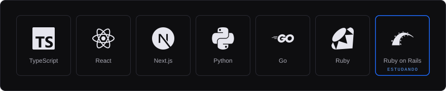

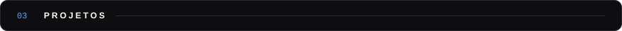

<table>
<tr>
<td width="50%" valign="top">
<a href="https://github.com/ayramesteodosio/dualsense-studio">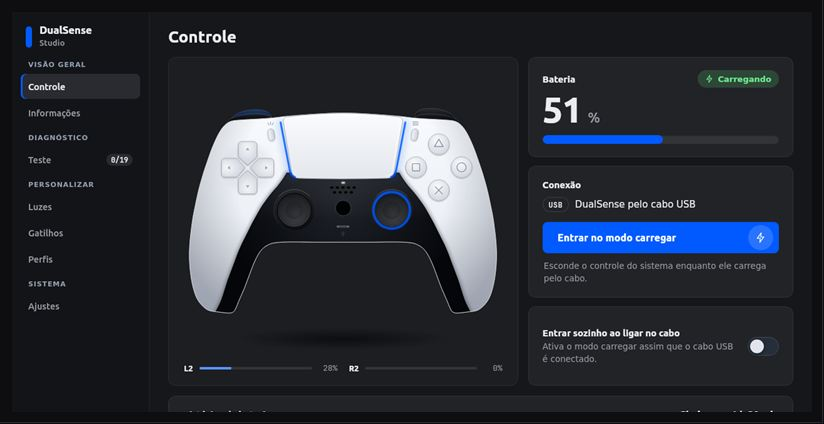</a>
 
<b><a href="https://github.com/ayramesteodosio/dualsense-studio">DualSense Studio</a></b> &nbsp;&middot;&nbsp; Python, HTML
 
Interface para o controle do PS5 no computador, com o controle desenhado na tela e acompanhando o real ao vivo. Luzes, gatilhos adaptativos, teste e perfis, para Windows, macOS e Linux.
</td>
<td width="50%" valign="top">
<a href="https://github.com/ayramesteodosio/dualsense-painel">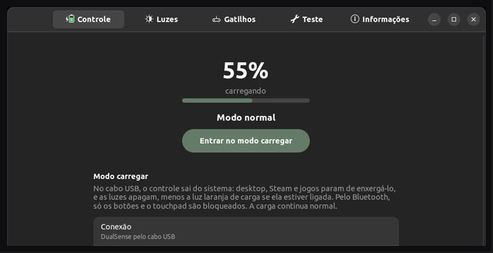</a>
 
<b><a href="https://github.com/ayramesteodosio/dualsense-painel">Painel do DualSense</a></b> &nbsp;&middot;&nbsp; Python
 
App para o controle do PS5 no computador: modo carregar, luzes, gatilhos adaptativos e teste de botões e sensores. GTK4 no Linux e Qt no Windows e macOS.
</td>
</tr>
<tr>
<td width="50%" valign="top">
<a href="https://github.com/ayramesteodosio/portfolio">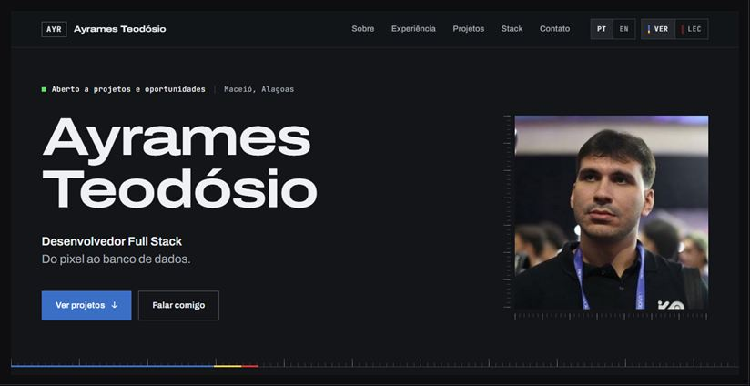</a>
 
<b><a href="https://github.com/ayramesteodosio/portfolio">Portfólio</a></b> &nbsp;&middot;&nbsp; TypeScript &nbsp;&middot;&nbsp; <a href="https://ayramesteodosio.github.io/portfolio/">ver site</a>
 
Meu portfólio em Next.js, React e TypeScript, em português e inglês.
</td>
<td width="50%" valign="top">
<a href="https://github.com/ayramesteodosio/FitWorkout">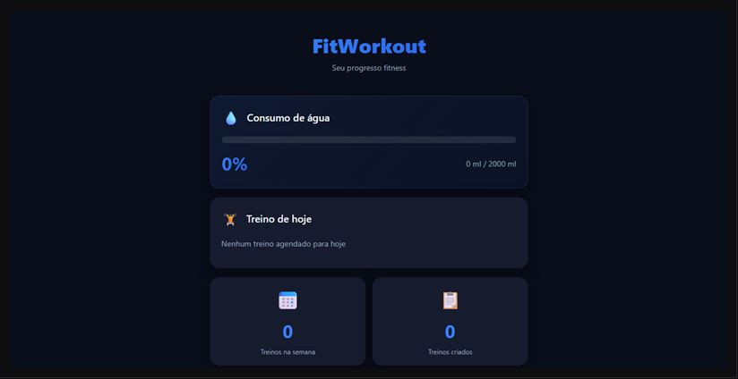</a>
 
<b><a href="https://github.com/ayramesteodosio/FitWorkout">FitWorkout</a></b> &nbsp;&middot;&nbsp; TypeScript &nbsp;&middot;&nbsp; <a href="https://fit-workout.vercel.app">ver demo</a>
 
Acompanhamento de consumo de água e treinos, com calendário da semana.
</td>
</tr>
</table>

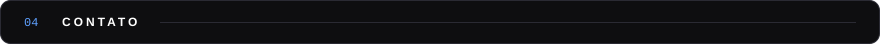

<a href="https://www.linkedin.com/in/ayrames-pereira">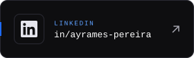</a> <a href="https://www.instagram.com/ay.core/">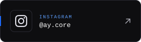</a> <a href="https://ayramesteodosio.github.io/portfolio/">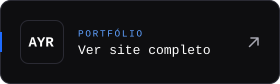</a>

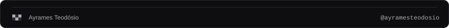
