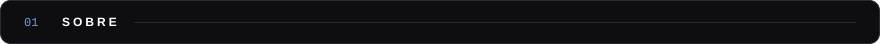
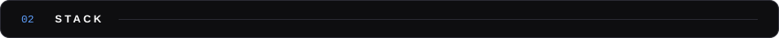

Desenvolvedor full-stack aberto a novas oportunidades. Desenvolvo com TypeScript, React e Next.js e hoje estudo Ruby on Rails. No tempo livre, estudo e jogo.

| Área | Tecnologias |
| --- | --- |
| **Linguagens** | TypeScript, Ruby, Python, Go |
| **Front-end** | React, Next.js |
| **Em estudo** | Ruby on Rails |

| Projeto | Descrição | Linguagem |
| --- | --- | --- |
| [dualsense-studio](https://github.com/ayramesteodosio/dualsense-studio) | Interface para o controle do PS5 no computador, com o controle desenhado ao vivo. | HTML |
| [dualsense-painel](https://github.com/ayramesteodosio/dualsense-painel) | Carregue, personalize e teste o controle do PS5 no Linux, Windows e macOS. | Python |
| [portfolio](https://github.com/ayramesteodosio/portfolio) ([site](https://ayramesteodosio.github.io/portfolio/)) | Meu portfólio: Next.js, React e TypeScript, em português e inglês. | TypeScript |
| [FitWorkout](https://github.com/ayramesteodosio/FitWorkout) ([demo](https://fit-workout.vercel.app)) | Projeto em TypeScript com demo publicada na Vercel. | TypeScript |

[LinkedIn](https://www.linkedin.com/in/ayrames-pereira) · [Instagram](https://www.instagram.com/ay.core/) · [Portfólio](https://ayramesteodosio.github.io/portfolio/)

